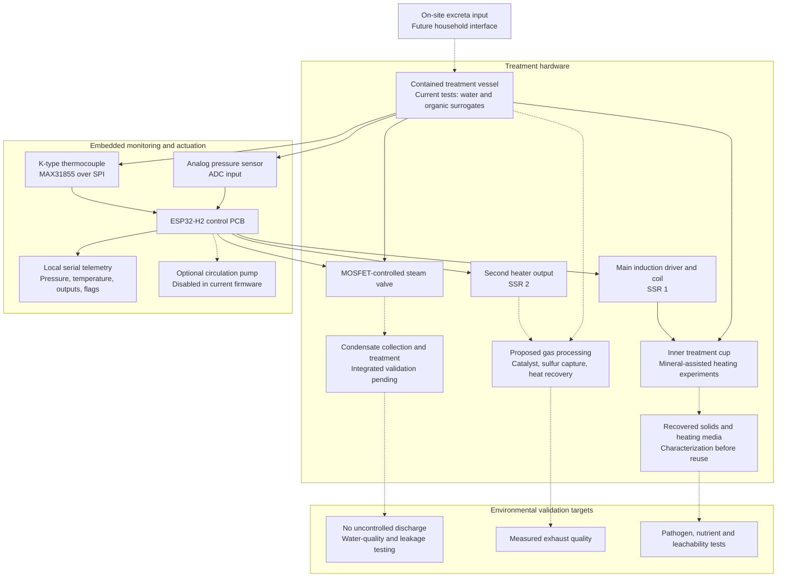

<div align="center">

# ShuddhiSetu

### Accelerating Nature. Protecting Every Drop.

**ShuddhiSetu: An Affordable, Nature-Inspired In-Situ Excreta Treatment and Groundwater Protection System**

On-site sanitation • Instrumented containment • Treatment at source • Resource recovery

[Prototype Gallery](#prototype-gallery) · [System Architecture](#system-architecture) · [Experimental Evidence](#experimental-evidence) · [Engineering Files](#engineering-files) · [Validation Roadmap](#validation-roadmap)

</div>

---

> **From containment to controlled treatment.** ShuddhiSetu aims to help rural households treat excreta where it is generated, reduce dependence on waste transport, and protect surrounding soil and groundwater. This repository contains a tangible engineering foundation: experimental treatment hardware, assembled custom PCBs, embedded control firmware, induction-heating trials, and mechanical design files.
>
> **Current maturity:** laboratory prototype using water and surrogate organic materials. Rural affordability, treatment of human excreta, pathogen reduction, groundwater protection, and agricultural reuse remain validation objectives.

<p align="center">
  
  <br>
  <em>Physical experimental setup: copper induction coil, sample vessel, driver electronics, and power supply.</em>
</p>

## The problem we address

**Organization:** Ministry of Jal Shakti (MoJS)<br>
**Problem statement:** On site containment-based Toilets: Innovative technological, biochemical, or nature-based interventions for expediting in-situ treatment of excreta without harming environment/ water table.

The supplied problem statement identifies a need to strengthen Individual Household Latrines under SBM(G): accelerate stabilization, reduce pathogens and sludge accumulation, recover nutrients, and protect soil and the water table. Rural deployment also needs to account for water scarcity, construction quality, sustained usage, affordability, and limited monitoring.

ShuddhiSetu adopts these as design requirements. Its broader identity accommodates biochemical treatment, nature-inspired interventions, smart monitoring, and resource recovery; **the implementation currently documented here concentrates on instrumented thermal treatment and mineral-assisted induction experiments.** Biochemical treatment is a future integration option, with no demonstrated biochemical module in this repository.

| Problem-statement requirement | ShuddhiSetu approach | Evidence and remaining work |
|---|---|---|
| Accelerate in-situ stabilization | Controlled drying and experimental thermal conversion within an on-site treatment module | Surrogate-material experiments exist; full excreta treatment time and stabilization need measurement |
| Enhance pathogen reduction | Develop a monitored treatment cycle with measurable temperature and exposure time | Temperature sensing exists; microbiological efficacy has not been established |
| Minimize sludge accumulation | Investigate drying and conversion of organic solids into a smaller residual stream | Quantified dry-solids mass balance and repeated-cycle trials are pending |
| Protect soil and groundwater | Design a contained treatment path with managed condensate, gases, and residual solids | Leakage, leachate quality, and hydrogeological suitability require validation |
| Recover useful resources | Investigate solid-product recovery and reuse of mineral heating media | Surrogate charring and qualitative magnetic separation are reported; nutrient retention and reuse safety need testing |
| Remain affordable and scalable | Standard components, custom control PCB, documented fabrication files, modular assemblies | Board BOM is documented; complete installed cost and operating cost are not established |
| Support sustained household use | Reduce operator burden through sensing and automatic actuation | Local serial monitoring and control exist; household usability and maintenance trials are pending |

## Prototype gallery

### Custom electronics: assembled hardware

<p align="center">
  
</p>

The control electronics have progressed beyond a breadboard. The photographed boards show physical assemblies; the repository also includes editable KiCad schematics and layout, a component BOM, manufacturing-layer exports, and drill files. The board brings pressure sensing, thermocouple input, heater switching, and valve drivers onto a common platform.

### Vessel integration and reactor concept

<table>
<tr>
<td width="50%" align="center"><br><strong>Physical vessel assembly</strong><br>Inner container, copper tubing, outer vessel, and fittings.</td>
<td width="50%" align="center"><br><strong>Reactor design concept</strong><br>Cutaway illustration of coil, liner, and inner treatment zone; this is a design visualization.</td>
</tr>
</table>

### Material experiments and sample outcomes

<table>
<tr>
<td width="50%" align="center"><br><strong>Bench experimentation</strong><br>Small-scale setup used to investigate heating behavior.</td>
<td width="50%" align="center"><br><strong>Surrogate sample result</strong><br>Visible material change from an experimental run; appearance alone does not establish sanitation or reuse safety.</td>
</tr>
</table>

## System architecture

The architecture separates material handling, embedded control, and environmental safeguards. Solid arrows below describe the prototype hardware/control path; dashed arrows identify proposed treatment and recovery connections that still need integrated validation.



### How the current prototype works

1. **Contain and instrument.** An experimental vessel holds the test material while pressure and temperature are measured.
2. **Apply controlled heat.** The conductive prototype uses an SSR-switched hot plate. The induction implementation provides a main coil output and a second heater output for the proposed gas-treatment zone.
3. **Manage vapor release.** Pressure hysteresis controls an electrically actuated valve. Earlier tests found that valve restriction prevented an instantaneous flash-pressure drop.
4. **Detect a low-pressure dry-state candidate.** Embedded firmware tracks a sustained low-pressure interval after cycle activation and latches heater shutdown. This is a control heuristic, not a measurement of pathogen destruction or complete treatment.
5. **Investigate conversion and recovery.** Separate induction trials explore magnetite, bentonite, and steel media with organic surrogates. Gas treatment, condensate treatment, and safe solid recovery require further integration.

## Control electronics and firmware

| Subsystem | Repository implementation |
|---|---|
| Controller | ESP32-H2 DEVKITM-1-N4 running ESP-IDF firmware |
| Temperature input | K-type thermocouple through MAX31855; SPI on GPIO0/1/2 |
| Pressure input | Analog sensor through voltage divider; induction firmware uses GPIO3 / ADC channel 2 and a 0–15 PSI calibration |
| Main heater | GPIO4, SSR output; proportional temperature control with time-window switching |
| Second heater | GPIO5, SSR output; cycle-linked enable, without independent temperature feedback |
| Valve | GPIO10, MOSFET-driven solenoid with pressure hysteresis |
| Optional pump / second valve | GPIO11; pump feature disabled in induction firmware |
| Monitoring | Local serial logs for pressure, filtered temperature, duty, actuator states, dry latch, and emergency trip |
| Fabrication assets | KiCad project, schematic, PCB layout, BOM, layer exports, and NC drill file |

**Current induction firmware settings:** 200°C main-heater target; valve opens at 1.20 PSI and closes at 1.05 PSI; cycle activation at 0.30 PSI; dry candidate at or below 0.15 PSI for 15 seconds; emergency trip at 14 PSI or 250°C. These are source-code settings, not a validated human-excreta treatment protocol. Older conductive-prototype documentation uses a different pressure range and thresholds.

The firmware implements an emergency latch that disables heater outputs and commands the valve open on an over-limit reading. The main heater also requires a valid thermocouple reading. These are software protections; independent mechanical pressure relief, sensor-fault handling across every output, and system-level safety verification remain engineering requirements.

**Next control-board revision:** a second thermocouple interface, a dedicated circulation-pump connection, and a flow-sensor header are documented in the [hardware revision roadmap](Project%20Files/PCB%20Design/PCB_v0.4.0_Induction_Revision_Plan.md). The high-temperature catalyst concept is not independently temperature-controlled by the present firmware.

## Experimental evidence

These are observations recorded in the repository, rather than independently certified performance results.

| Experiment / artifact | Recorded observation | What it supports |
|---|---|---|
| Magnetite induction trial | 5 g reached **740°F (about 393°C) at 60 seconds** | Small-sample induction response; not whole-reactor heating time |
| Equal-mass carbon-steel comparison | About 5 g reached **130°F at 60 seconds**; equal-volume steel behaved differently | Media selection and geometry need controlled comparisons |
| Water evaporation trial | A crucible with magnetite and a cup of water reportedly evaporated its water in **under 8 minutes** | Bench dewatering feasibility; input energy and precise water mass were not reported |
| Organic surrogate trial | Cheese-puff samples reached a reported **833°F (about 445°C)**; approximately **16 minutes** powered time | Visible charring of surrogate material in an open-air experiment |
| PCB bring-up | Pressure readings, valve actuation, dry-state logic, and serial output were exercised | Integrated sensing and actuation on physical hardware |
| Hardware rework | SSR traces remapped to GPIO4/5; D2/D5 replaced; valve operation rechecked | Documented engineering iteration following physical test failures |
| Mineral recovery demonstration | Magnetic separation of a magnetite-mixed sample was reported | Qualitative feasibility of heating-media recovery |

**Evidence to inspect:** [Induction measurements](Induction%20experimental%20data.md) · [Dated experiment and bring-up logs](Project%20Files/Progress%20Reports.md) · [Conductive prototype records](Project%20Files/Conductive%20Heating%20Prototype/README.md).

The bread-test records contain conflicting accounts of automatic shutoff: the progress log reports success, while the conductive prototype's known-issues and key-results sections report a missed dryness trigger. A repeated, instrumented trial is needed before presenting that outcome as established. The current 200°C firmware target and 250°C trip also differ from the higher temperatures recorded in separate material experiments.

## Groundwater protection by design

Protecting every drop requires accounting for **all output streams**, not only the treated solids. ShuddhiSetu's proposed environmental boundary includes:

- **Containment:** verify vessel integrity, seals, connections, and leak containment before any household deployment.
- **Liquids:** collect condensate and characterize its contamination; evaporation does not by itself make the liquid safe for discharge.
- **Gases:** evaluate particulate removal, sulfur management, gas treatment, and emissions. The [syngas processing memo](Project%20Files/Memos/Syngas_Processing_Memo.md) documents concepts for ceramic components, mineral capture, and heat recovery.
- **Solids:** measure stabilization, residual pathogens, nutrient availability, and leachability before proposing agricultural use.
- **Site suitability:** evaluate performance under high water tables, flooding, variable soil conditions, and realistic household loading.

Groundwater protection, lower greenhouse-gas emissions, and safe compost or char use are intended outcomes. They have not yet been demonstrated by the available prototype data.

## Affordability and rural deployment

The control-board documentation records an approximately **US$48 component BOM at March 2026 pricing**. This is a historical electronics estimate, excluding the complete reactor, power supply, heaters, installation, and maintenance. It must not be presented as the cost of a household system.

The experimental setup uses an 1800 W-rated induction driver and a 48 V power architecture. Rated power is not measured energy per treatment cycle. Rural suitability will depend on measured energy per kilogram of wet input, electricity availability, household throughput, local sourcing, repairability, and whole-system lifecycle cost.

The intended deployment model treats material at the source and reduces reliance on centralized handling. Residual-solid removal, consumable replacement, and safe servicing still need an explicit maintenance plan; the prototype does not establish maintenance-free operation.

## Validation roadmap

| Workstream | Measurements needed before making a field-performance claim |
|---|---|
| Treatment performance | Defined input mass/moisture, cycle time, temperature distribution, residence time, dry-solids reduction, repeated-cycle performance |
| Pathogen reduction | Qualified laboratory testing of appropriate indicators and organisms; verified treatment exposure throughout the material |
| Water and soil protection | Liquid mass balance, condensate/leachate quality, leakage tests, solid-product leachability, site-specific groundwater risk |
| Nutrient recovery | Nitrogen/phosphorus/potassium mass balance, nutrient availability, solid-product quality, and controlled reuse trials |
| Energy and climate | Metered kWh per cycle and per kilogram, exhaust measurements, comparison against an explicitly defined baseline |
| Reliability | Sensor faults, valve blockage, power loss, coil insulation, cooling, pressure relief, and safe restart behavior |
| Rural usability and cost | Installed BOM, local procurement, cleaning and service burden, user acceptance, and household-scale trials |
| Broader treatment options | Evaluate biochemical or nature-inspired modules against measured treatment, containment, energy, and maintenance needs |

## Engineering files

| Explore | Contents |
|---|---|
| [Presentation](Presentations/ShuddhiSetu_Slide_Deck.html) | Local HTML project deck; some assets require internet access |
| [Control-board documentation](Project%20Files/PCB%20Design/Control%20Board.md) | Circuit architecture, power, sensors, outputs, and board specifications |
| [KiCad schematic](Project%20Files/PCB%20Design/Control%20Board.kicad_sch) · [PCB layout](Project%20Files/PCB%20Design/Control%20Board.kicad_pcb) | Editable electronics design sources |
| [Manufacturing-layer exports](Project%20Files/PCB%20Design/Gerber%20Files/) · [Drill files](Project%20Files/PCB%20Design/Drill%20Files/) | Layer PDFs and NC drill data; verify fabrication package before ordering |
| [Electronics BOM](Project%20Files/PCB%20Design/Bio_Char_BOM_Mouser_FINAL.xlsx) · [Prototype BOM](Project%20Files/BOM/1st_Action_Pyrolysis_BOM.md) | Component and experimental hardware records |
| [Mechanical CAD](Project%20Files/CAD%20Files/) | FreeCAD assemblies, frame revisions, vessel models, and fittings |
| [Induction firmware](Project%20Files/Induction%20Heating%20Prototype/Firmware/) | ESP-IDF controller implementation and build scripts |
| [Conductive firmware](Project%20Files/Conductive%20Heating%20Prototype/Firmware/) | Earlier hot-plate implementation |
| [Vapor-stack architecture](Project%20Files/Memos/vapor_processing_stack_blueprint.html) | Proposed gas-processing design visualization |
| [Design notes](DESIGN_IDEAS.md) · [Progress reports](Project%20Files/Progress%20Reports.md) | Design rationale, observations, unresolved issues, and iteration history |

### Software checks

The root-level Python controllers provide separate logic implementations for heater control, valve control, and dryness detection. Their tests can be run from the repository root:

```bash
python3 -m unittest discover -p 'test_*.py'
```

These checks exercise Python control logic; they do not establish embedded-firmware equivalence, hardware safety, or treatment efficacy.

### Firmware build

The firmware directories contain platform-specific build scripts and ESP-IDF configuration. Review the [induction firmware guide](Project%20Files/Induction%20Heating%20Prototype/README.md) before building or flashing. Build scripts may download the SDK and clear cached build artifacts. Hardware pin mapping, pressure calibration, and protection limits must match the actual assembly.

## Source and license

This project builds on the technical materials in the [original Biochar-Toilet repository](https://github.com/PubInv/Biochar-Toilet), adapted here under the ShuddhiSetu identity. The included [GNU GPL v3 license](LICENSE) is retained. Photographs and experimental observations document that source project's engineering foundation; the ShuddhiSetu branding does not imply that all photographed work was newly produced for this submission.

---

<div align="center">

**ShuddhiSetu**<br>
*Accelerating Nature. Protecting Every Drop.*

</div>
